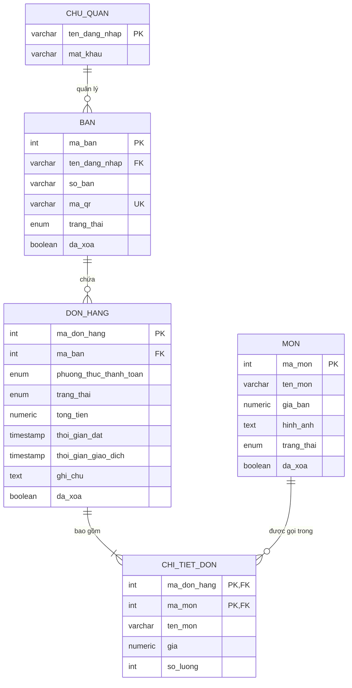

# 📚 CÀ PHÊ 458 — TÀI LIỆU PHÂN TÍCH & THIẾT KẾ HỆ THỐNG

Thư mục này lưu trữ toàn bộ hồ sơ kỹ thuật, tài liệu đặc tả yêu cầu phần mềm (SRS), phân tích ca sử dụng (Use Cases), thiết kế cơ sở dữ liệu, đặc tả màn hình giao diện chuẩn Figma và bộ kịch bản kiểm thử (Test Cases) của dự án **Hệ thống Quản lý và Gọi món tại bàn bằng mã QR cho quán Cà phê 458** (`50K142.08`).

---

## 🗂️ 1. CẤU TRÚC THƯ MỤC TÀI LIỆU

```text
Document/
├── TÀI LIỆU ĐẶC TẢ YÊU CẦU PHẦM MỀM VÀ THIẾT KẾ HỆ THỐNG.docx  # Hồ sơ đặc tả tổng hợp hoàn chỉnh
│
├── Document_Decomposition/                                      # Tài liệu định dạng Word phân rã chi tiết
│   ├── MÔ TẢ TỔNG QUAN VỀ ĐỀ TÀI.docx
│   ├── YÊU CẦU CHỨC NĂNG_PHI CHỨC NĂNG.docx
│   ├── SƠ ĐỒ LỚP_THIẾT KẾ CƠ SỞ DỮ LIỆU.docx
│   ├── THIẾT KẾ MÀN HÌNH_ÁNH XẠ .docx
│   ├── ĐẶC TẢ GIAO DIỆN KHÁCH HÀNG.docx
│   ├── ĐẶC TẢ MÀN HÌNH GIAO DIỆN ĐĂNG NHẬP .docx
│   ├── ĐẶC TẢ MÀN HÌNH GIAO DIỆN QUẢN LÝ GỌI MÓN .docx
│   ├── ĐẶC TẢ MÀN HÌNH QUẢN LÝ MENU.docx
│   ├── ĐẶC TẢ MÀN HÌNH GIAO DIỆN QUẢN LÝ BÀN.docx
│   ├── ĐẶC TẢ MÀN HÌNH GIAO DIỆN QUẢN LÝ DOANH THU.docx
│   ├── ĐẶC TẢ MÀN HÌNH GIAO DIỆN ĐỔI MẬT KHẨU.docx
│   └── ĐĂC TẢ MÀN HÌNH HÌNH GIAO DIỆN ĐĂNG XUẤT.docx
│
└── _md/                                                         # Tài liệu định dạng Markdown tra cứu nhanh
    ├── MO_TA_TONG_QUAN_VE_dE_TAI.md                             # Tổng quan nghiệp vụ quán & giải pháp
    ├── NFR_phi_chuc_nang.md                                     # Yêu cầu phi chức năng (bảo mật, hiệu năng)
    ├── SO_dO_LOP_THIET_KE_CO_SO_DU_LIEU.md                      # Thiết kế 5 bảng CSDL & ràng buộc
    ├── THIET_KE_MAN_HINH_ANH_XA.md                              # Bảng ánh xạ 16 màn hình vào 8 Use Cases
    ├── UC_1_dang_nhap.md                                        # Đặc tả chi tiết Use Case 1: Đăng nhập
    ├── UC_2_Quan_ly_goi_mon.md                                  # Đặc tả chi tiết Use Case 2: Quản lý gọi món
    ├── UC_3_Quan_ly_menu.md                                     # Đặc tả chi tiết Use Case 3: Quản lý menu
    ├── UC_4_Quan_ly_ban.md                                      # Đặc tả chi tiết Use Case 4: Quản lý bàn
    ├── UC_5_Quan_ly_doanh_thu.md                                # Đặc tả chi tiết Use Case 5: Quản lý doanh thu
    ├── UC_6_doi_mat_khau.md                                     # Đặc tả chi tiết Use Case 6: Đổi mật khẩu
    ├── UC_7_dat_mon.md                                          # Đặc tả chi tiết Use Case 7: Khách đặt món
    ├── UC_8_dang_xuat.md                                        # Đặc tả chi tiết Use Case 8: Đăng xuất
    ├── dAC_TA_GIAO_DIEN_KHACH_HANG.md                           # Chi tiết UI khách hàng (U1, U2, U3, U4)
    ├── dAC_TA_MAN_HINH_GIAO_DIEN_dANG_NHAP.md                   # Chi tiết UI đăng nhập (U5)
    ├── dAC_TA_MAN_HINH_GIAO_DIEN_QUAN_LY_GOI_MON.md             # Chi tiết UI danh sách & chi tiết đơn (U7, U8)
    ├── dAC_TA_MAN_HINH_QUAN_LY_MENU.md                          # Chi tiết UI thực đơn (U9, U10, U11)
    ├── dAC_TA_MAN_HINH_GIAO_DIEN_QUAN_LY_BAN.md                 # Chi tiết UI quản lý sơ đồ bàn (U12, U13)
    ├── dAC_TA_MAN_HINH_GIAO_DIEN_QUAN_LY_DOANH_THU.md           # Chi tiết UI báo cáo doanh thu (U14, U15)
    ├── dAC_TA_MAN_HINH_GIAO_DIEN_dOI_MAT_KHAU.md                # Chi tiết UI đổi mật khẩu (U16)
    ├── dAC_TA_MAN_HINH_HINH_GIAO_DIEN_dANG_XUAT.md              # Chi tiết Modal đăng xuất
    ├── TEST_CASES_BACKEND_API.md                                # Bảng danh mục kịch bản kiểm thử API
    └── Cafe458_Backend_API.postman_collection.json              # Bộ sưu tập Postman kiểm thử tự động
```

---

## 📑 2. DANH MỤC 8 USE CASES VÀ QUY TẮC NGHIỆP VỤ (BR)

| Mã UC | Tên Use Case | Tác nhân chính | Tóm tắt luồng nghiệp vụ | Quy tắc nghiệp vụ chính (BR) |
| :---: | :--- | :---: | :--- | :--- |
| **UC 1** | **Đăng nhập hệ thống** | Chủ quán | Nhập tài khoản, mật khẩu; hệ thống kiểm tra băm bcrypt và cấp JWT token. | BR-UC1: Khóa/báo lỗi khi sai thông tin; không cho truy cập trái phép trang quản trị. |
| **UC 2** | **Quản lý gọi món & đơn** | Chủ quán | Xem danh sách đơn theo ngày, xem chi tiết, xác nhận đã nhận tiền (tiền mặt/chuyển khoản), xóa đơn. | BR-UC2: Chỉ xóa mềm đơn; xác nhận thanh toán ghi nhận `thoi_gian_giao_dich`. |
| **UC 3** | **Quản lý menu món** | Chủ quán | Xem thực đơn, thêm món mới kèm ảnh, sửa thông tin món, ẩn/hiển thị món, xóa món. | BR-UC3: Giá bán > 0; tên món không trùng lặp (không phân biệt hoa thường); lưu trữ ảnh trên Cloud. |
| **UC 4** | **Quản lý sơ đồ bàn** | Chủ quán | Xem danh sách bàn, thêm bàn mới kèm mã QR định danh, tải mã QR, dọn bàn về trạng thái 'Trống'. | BR-UC4: Số bàn không trùng lặp; chỉ cho phép đưa bàn về 'Trống' khi không còn đơn chưa xác nhận. |
| **UC 5** | **Quản lý doanh thu** | Chủ quán | Xem tổng quan doanh thu theo ngày/tháng/năm; xem chi tiết số ly bán ra và danh sách món bán chạy nhất. | BR-UC5: Doanh thu chỉ tính các đơn 'Đã xác nhận thanh toán' và chưa bị xóa mềm; múi giờ UTC+7. |
| **UC 6** | **Đổi mật khẩu** | Chủ quán | Nhập mật khẩu cũ, mật khẩu mới và xác nhận mật khẩu mới. | BR-UC6: Mật khẩu cũ phải khớp; mật khẩu mới không để trống và phải trùng khớp với ô xác nhận. |
| **UC 7** | **Khách gọi món qua QR** | Khách hàng | Quét mã QR tại bàn, chọn món, xem giỏ hàng, ghi chú và thanh toán (VietQR hoặc Tiền mặt). | BR-UC7: Tự động đổi trạng thái bàn sang 'Đang phục vụ'; sinh mã VietQR chuẩn EMVCo tự động. |
| **UC 8** | **Đăng xuất** | Chủ quán | Nhấn vào Avatar "C" chọn "Đăng xuất" -> xác nhận trên popup -> hủy session. | BR-UC8: Xóa token JWT khỏi trình duyệt và điều hướng về màn hình `/login`. |

---

## 📐 3. BẢNG ÁNH XẠ 16 MÀN HÌNH GIAO DIỆN (U1 — U16)

| Mã UI | Màn hình | Đối tượng | Phân rã Use Case | Đường dẫn Route |
|:---:|:---|:---:|:---:|:---|
| **U1** | Thực đơn chọn món | Khách hàng | UC 7.1, UC 7.2 | `/menu?qr={ma_qr}` |
| **U2** | Giỏ hàng & Thanh toán | Khách hàng | UC 7.2 | `/checkout` |
| **U3** | Thanh toán Chuyển khoản VietQR | Khách hàng | UC 7.2 | `/payment-transfer` |
| **U4** | Thanh toán Tiền mặt | Khách hàng | UC 7.2 | `/payment-cash` |
| **U5** | Đăng nhập Chủ quán | Chủ quán | UC 1 | `/login` |
| **U6** | Trang chủ Quản trị | Chủ quán | UC 1, UC 8 | `/admin` |
| **U7** | Danh sách Đơn hàng | Chủ quán | UC 2.1, 2.2, 2.3 | `/admin/orders` |
| **U8** | Chi tiết Đơn hàng | Chủ quán | UC 2.1, 2.2, 2.3 | `/admin/orders/:id` |
| **U9** | Quản lý Thực đơn (Menu) | Chủ quán | UC 3.1, 3.3 | `/admin/menu` |
| **U10** | Thêm món mới | Chủ quán | UC 3.2 | `/admin/menu/add` |
| **U11** | Chỉnh sửa thông tin món | Chủ quán | UC 3.4 | `/admin/menu/edit/:id` |
| **U12** | Sơ đồ & Quản lý bàn | Chủ quán | UC 4.1, 4.3, 4.4 | `/admin/tables` |
| **U13** | Thêm bàn & Cấp mã QR | Chủ quán | UC 4.2 | `/admin/tables/add` & `/admin/tables/:id` |
| **U14** | Báo cáo Tổng doanh thu | Chủ quán | UC 5.1 | `/admin/revenue` |
| **U15** | Chi tiết Doanh thu & Món chạy | Chủ quán | UC 5.2, 5.3 | `/admin/revenue/detail` |
| **U16** | Đổi mật khẩu tài khoản | Chủ quán | UC 6 | `/admin/change-password` |

---

## 🗄️ 4. MÔ HÌNH DỮ LIỆU & QUAN HỆ (DATA MODEL)

Lược đồ dữ liệu bao gồm **5 bảng cốt lõi** với các ràng buộc toàn vẹn:



---

## 🧪 5. KIỂM THỬ VÀ POSTMAN COLLECTION

1. **Bộ sưu tập Postman (`_md/Cafe458_Backend_API.postman_collection.json`):**
   * Chứa đầy đủ các request có kèm assertions tự động cho tất cả các endpoint (Auth, Menu, Orders, Tables, Reports, Customer).
   * Hỗ trợ lưu trữ tự động `access_token` vào biến môi trường Postman sau khi đăng nhập thành công.
2. **Kịch bản kiểm thử API (`_md/TEST_CASES_BACKEND_API.md`):**
   * Bao gồm ma trận test cases: Trường hợp thành công (Happy Path), trường hợp biên (Edge Cases), kiểm tra ràng buộc dữ liệu (Validation Error 422), và kiểm tra bảo mật truy cập (Unauthorized 401 / Forbidden 403 / Conflict 409).
