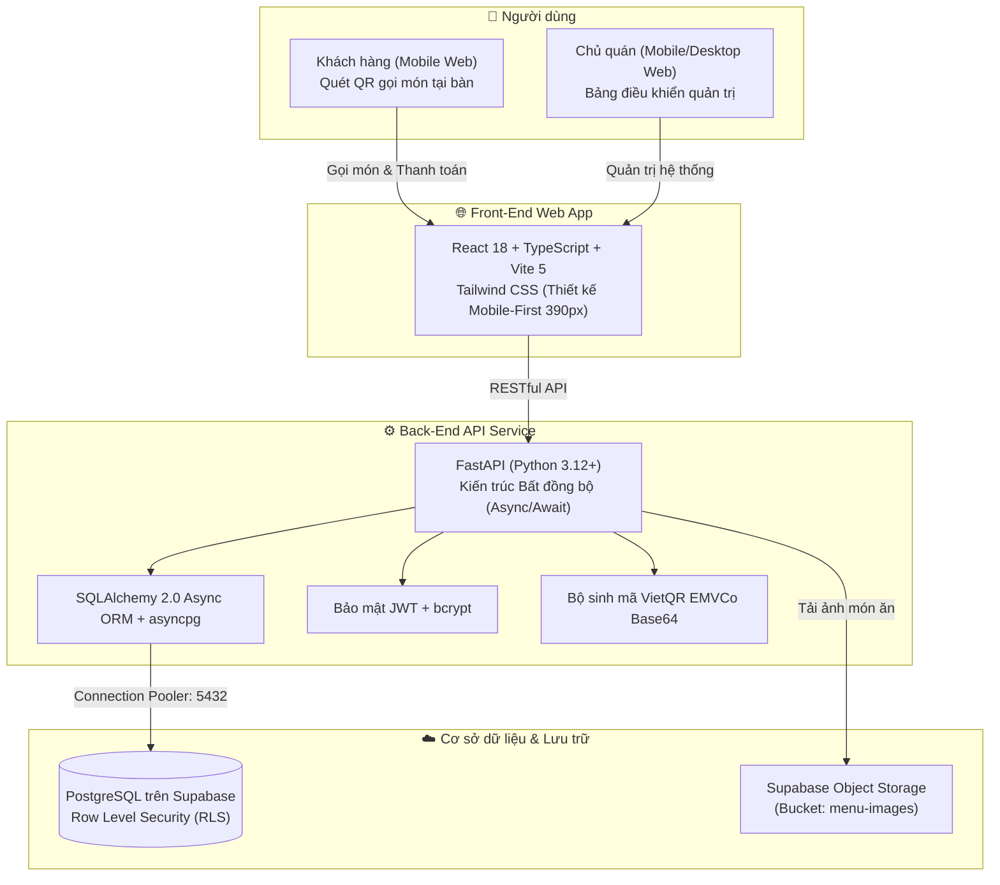

# ☕ HỆ THỐNG QUẢN LÝ & GỌI MÓN TẠI BÀN — CÀ PHÊ 458

> **Dự án:** Trang web hệ thống bán hàng quán Cà phê 458  
> **Mã học phần:** 50K142.08 — Phân tích Thiết kế Hệ thống Thông tin  
> **Địa chỉ quán thực tế:** 458 Trưng Nữ Vương, Hải Châu, Đà Nẵng

---

## 🌐 1. ĐƯỜNG DẪN TRUY CẬP WEBSITE TRỰC TUYẾN (WEB SAU KHI DEPLOY)

Hệ thống web đã được triển khai hoàn tất và hoạt động trực tuyến với 2 phân hệ người dùng chính:

| Phân hệ Web                      |  Đối tượng sử dụng  | Đường dẫn trực tiếp (Web Link)                                                                                           | Mô tả & Thao tác                                                                                                                                                                                                                                               |
| :------------------------------- | :-----------------: | :----------------------------------------------------------------------------------------------------------------------- | :------------------------------------------------------------------------------------------------------------------------------------------------------------------------------------------------------------------------------------------------------------- |
| **Phần 1: Giao diện Khách hàng** |   Khách tại quán    | [https://cafe458-system-50-k142-08.vercel.app/menu?qr=ban03](https://cafe458-system-50-k142-08.vercel.app/menu?qr=ban03) | Khách quét mã QR tại bàn để xem thực đơn, chọn món, ghi chú và thanh toán tại chỗ.<br>_(Các bàn thử nghiệm khác: [Bàn 01](https://cafe458-system-50-k142-08.vercel.app/menu?qr=ban01) • [Bàn 05](https://cafe458-system-50-k142-08.vercel.app/menu?qr=ban05))_ |
| **Phần 2: Giao diện Chủ quán**   | Chủ quán / Quản trị | [https://cafe458-system-50-k142-08.vercel.app/login](https://cafe458-system-50-k142-08.vercel.app/login)                 | Màn hình đăng nhập quản trị hệ thống: duyệt đơn hàng thời gian thực, quản lý menu món, sơ đồ bàn và theo dõi doanh thu.                                                                                                                                        |

---

## 🔑 2. THÔNG TIN TÀI KHOẢN VÀ MẬT KHẨU ĐĂNG NHẬP

Sử dụng tài khoản dưới đây để đăng nhập vào phân hệ quản trị của Chủ quán tại liên kết `/login`:

| Loại tài khoản          | Tên đăng nhập (`ten_dang_nhap`) | Mật khẩu (`mat_khau`) | Quyền hạn / Mục đích sử dụng                                                                                    |
| :---------------------- | :-----------------------------: | :-------------------: | :-------------------------------------------------------------------------------------------------------------- |
| **Chủ quán chính thức** |         `admin_cafe458`         | `MatKhauChuQuan458!`  | **Toàn quyền quản trị:** Xem & duyệt đơn, quản lý thực đơn, cấp mã QR bàn, xem báo cáo doanh thu, đổi mật khẩu. |

> 📌 **Lưu ý bảo mật:** Mật khẩu trong cơ sở dữ liệu được mã hóa một chiều bằng thuật toán `bcrypt`. Phiên đăng nhập được duy trì an toàn thông qua JWT Bearer Token.

---

## 💳 3. THÔNG TIN THANH TOÁN VIETQR CỦA QUÁN

Khi khách hàng chọn phương thức thanh toán **Chuyển khoản**, hệ thống tự động sinh mã VietQR (NAPAS 247) chuẩn EMVCo:

- **Ngân hàng:** `VPBank` (Ngân hàng TMCP Việt Nam Thịnh Vượng — Mã BIN: `970432`)
- **Số tài khoản:** `616108751`
- **Chủ tài khoản:** `HKD CA PHE 458`
- **Nội dung thanh toán:** Tự động điền theo cú pháp `Bàn {Số_bàn}` (Ví dụ: `Bàn 03`)
- **Số tiền:** Tự động khớp chính xác 100% tổng giá trị đơn hàng.

---

## 📖 4. GIỚI THIỆU TỔNG QUAN HỆ THỐNG & USE CASES

Hệ thống cung cấp giải pháp toàn diện cho hoạt động kinh doanh của quán Cà phê 458:

- **Khách hàng:** Quét mã QR tại bàn bằng điện thoại thông minh để xem món, gọi món, chọn phương thức thanh toán (VietQR hoặc Tiền mặt) mà không cần cài đặt ứng dụng.
- **Chủ quán:** Nhận thông báo âm thanh và đếm số lượng đơn mới theo thời gian thực (chu kỳ 5 giây), xác nhận nhận tiền, cập nhật món và giá bán kèm hình ảnh tải lên đám mây, cấp mã QR bàn mới và xem báo cáo doanh thu.

### Danh mục 8 Use Cases & 16 Màn hình:

|  STT  | Use Case | Tên chức năng                |  Phân hệ   | Màn hình tương ứng (UI)                                                           |
| :---: | :------- | :--------------------------- | :--------: | :-------------------------------------------------------------------------------- |
| **1** | **UC 1** | Đăng nhập hệ thống           |  Chủ quán  | `U5: /login`                                                                      |
| **2** | **UC 2** | Quản lý gọi món & đơn hàng   |  Chủ quán  | `U7: /admin/orders`, `U8: /admin/orders/:id`                                      |
| **3** | **UC 3** | Quản lý thực đơn (Menu)      |  Chủ quán  | `U9: /admin/menu`, `U10: /admin/menu/add`, `U11: /admin/menu/edit/:id`            |
| **4** | **UC 4** | Quản lý sơ đồ bàn & mã QR    |  Chủ quán  | `U12: /admin/tables`, `U13: /admin/tables/add`, Chi tiết bàn                      |
| **5** | **UC 5** | Quản lý & báo cáo doanh thu  |  Chủ quán  | `U14: /admin/revenue`, `U15: /admin/revenue/detail`                               |
| **6** | **UC 6** | Đổi mật khẩu tài khoản       |  Chủ quán  | `U16: /admin/change-password`                                                     |
| **7** | **UC 7** | Xem menu & đặt món qua mã QR | Khách hàng | `U1: /menu?qr=...`, `U2: /checkout`, `U3: /payment-transfer`, `U4: /payment-cash` |
| **8** | **UC 8** | Đăng xuất khỏi hệ thống      |  Chủ quán  | Modal xác nhận trên `AdminLayout`                                                 |

---

## 🏛️ 5. KIẾN TRÚC & CÔNG NGHỆ (TECH STACK)



- **Front-End:** React 18, TypeScript 5, Vite 5, Tailwind CSS 3, React Router DOM v6, Axios, Lucide React, TanStack Query.
- **Back-End:** Python 3.12, FastAPI, Pydantic v2, SQLAlchemy 2.0 (Asyncio), `asyncpg`, Alembic, PyJWT, `bcrypt`, `qrcode[pil]`.
- **Cơ sở dữ liệu:** PostgreSQL 15+ trên Supabase với Row Level Security (RLS) cho cả 5 bảng lõi (`chu_quan`, `ban`, `mon`, `don_hang`, `chi_tiet_don`).
- **Lưu trữ ảnh:** Supabase Object Storage bucket `menu-images`.

---

## 📂 6. CẤU TRÚC THƯ MỤC DỰ ÁN

```text
cafe458-system-50K142.08/
├── Back-End/                 # [1] Dịch vụ máy chủ API (Python + FastAPI)
│   ├── app/                  # Mã nguồn chính (core, infrastructure, modules)
│   ├── alembic/              # Kịch bản di chuyển lược đồ CSDL
│   ├── scripts/              # Kịch bản khởi tạo (seed_owner.py)
│   ├── tests/                # Bộ kiểm thử tự động pytest
│   ├── Dockerfile            # Cấu hình container hóa máy chủ
│   ├── requirements.txt      # Danh mục thư viện phụ thuộc
│   └── README.md             # Hướng dẫn chi tiết cho Back-End
│
├── Front-End/                # [2] Ứng dụng giao diện người dùng (React + TypeScript)
│   ├── src/                  # Mã nguồn giao diện (components, pages, contexts, services)
│   ├── public/               # Tài nguyên tĩnh (ảnh nền, favicon)
│   ├── vercel.json           # Cấu hình rewrite URL cho Single Page App
│   ├── package.json          # Danh mục thư viện npm
│   └── README.md             # Hướng dẫn chi tiết cho Front-End
│
├── Document/                 # [3] Hồ sơ phân tích thiết kế & tài liệu dự án
│   ├── Document_Decomposition/ # Tài liệu Word phân rã chi tiết
│   ├── _md/                  # Tài liệu Markdown đặc tả 8 Use Cases & Test Cases
│   ├── TÀI LIỆU ĐẶC TẢ...docx # Hồ sơ đặc tả tổng hợp hoàn chỉnh
│   └── README.md             # Hướng dẫn và tra cứu tài liệu
│
└── README.md                 # Tài liệu tổng quan duy nhất này
```

---

## 🚀 7. HƯỚNG DẪN CÀI ĐẶT & CHẠY LOCAL (QUICK START)

### 7.1. Chạy Back-End (Terminal 1)

```bash
cd Back-End

# Cài đặt thư viện bằng uv (hoặc pip install -r requirements.txt):
uv sync

# Cập nhật cấu trúc database & seed tài khoản chủ quán:
alembic upgrade head
python scripts/seed_owner.py

# Khởi chạy máy chủ API:
uvicorn app.main:app --reload --host 0.0.0.0 --port 8000
```

### 7.2. Chạy Front-End (Terminal 2)

```bash
cd Front-End

# Cài đặt thư viện:
npm install

# Tạo file cấu hình môi trường:
copy .env.example .env    # Trên Windows (Linux/Mac dùng: cp .env.example .env)

# Khởi chạy giao diện:
npm run dev
```

> 👉 Mở trình duyệt tại: **`http://localhost:5173`** (Khuyến nghị bật chế độ Responsive `F12` mô phỏng màn hình iPhone 390px để có trải nghiệm tốt nhất).

---

## 🛡️ 8. QUY TRÌNH LÀM VIỆC NHÓM TRÊN GITHUB

Dự án sử dụng duy nhất nhánh **`main`** với ranh giới phân công độc lập:

- **Dev Back-End:** Thao tác trong `Back-End/`.
- **Dev Front-End:** Thao tác trong `Front-End/`.
- **Tài liệu:** Thao tác trong `Document/`.

```bash
# 1. Kéo bài mới về trước khi làm
git pull origin main

# 2. Thêm đúng thư mục của mình
git add Back-End/     # hoặc Front-End/ hoặc Document/

# 3. Commit rõ ràng theo Use Case
git commit -m "[FE] Hoàn thiện giao diện thanh toán VietQR UC_7.2"

# 4. Đẩy bài an toàn
git pull origin main
git push origin main
```

---

## ✅ 9. TRẠNG THÁI HỆ THỐNG & SẴN SÀNG PHÁT HÀNH (RELEASE READINESS)

- **Build thành phẩm:** Front-End biên dịch thành công 100% với Vite 5 và TypeScript (`tsc && vite build`), hoàn toàn không có lỗi cú pháp hay thiếu kiểu dữ liệu.
- **Định tuyến SPA:** Đã cấu hình tệp `vercel.json` phục vụ chuyển hướng toàn bộ các route sâu (`/menu?qr=...`, `/admin/orders`, `/login`) về `index.html`, ngăn ngừa lỗi `404 Not Found` khi người dùng F5 tải lại trang.
- **Cơ sở dữ liệu & RLS:** Đã áp dụng đầy đủ Row Level Security (RLS) trên 5 bảng PostgreSQL, ràng buộc xóa mềm (Soft Delete) và Partial Unique Index chống trùng lặp dữ liệu.
- **Kiểm thử tự động:**
  - Front-End (`vitest`): Đạt **100% (11/11 tests pass)**.
  - Back-End (`pytest`): Đạt **26/27 tests pass** bao phủ toàn bộ luồng nghiệp vụ xác thực, đặt món, chuyển trạng thái bàn và tính toán doanh thu.

---

## 📞 10. LIÊN HỆ & THÔNG TIN DỰ ÁN

- **Học phần:** Phân tích Thiết kế Hệ thống Thông tin (50K14.2)
- **Kho lưu trữ GitHub:** [qbao020206-tech/cafe458-system-50K142.08](https://github.com/qbao020206-tech/cafe458-system-50K142.08)
